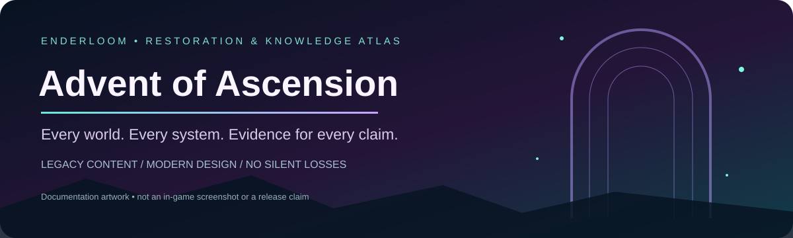
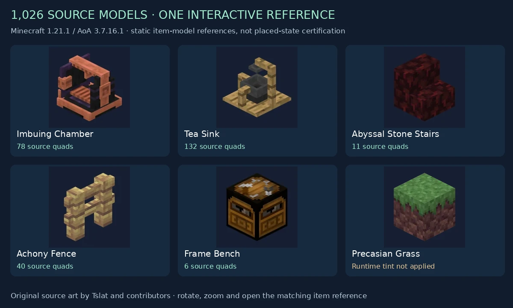
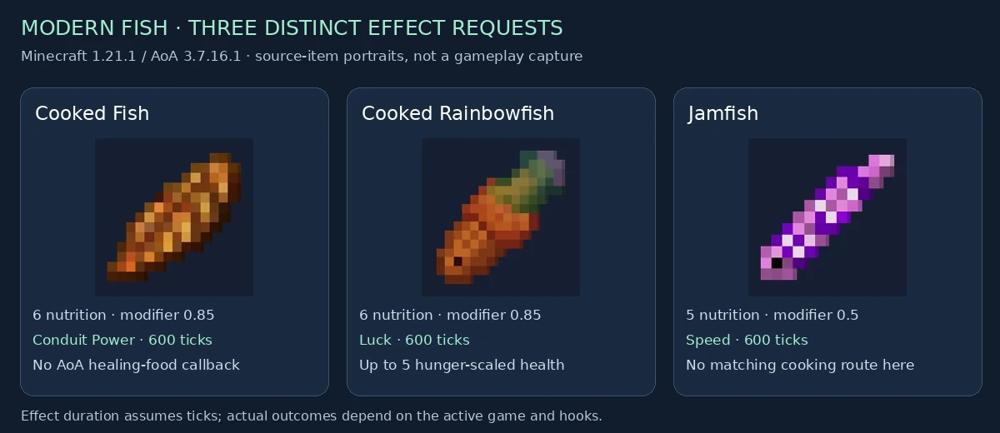
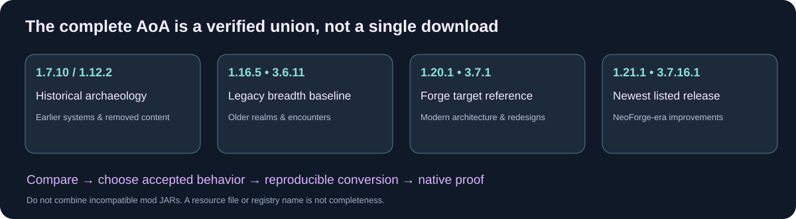
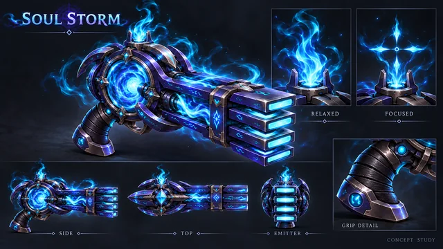

<strong>Legacy breadth. Modern systems. Document the adventure. Prove the restoration.</strong>

<a href="https://github.com/Herbertofury/Advent-of-Ascension/wiki">Explore the wiki</a> · <a href="docs/Version-Matrix.md">Choose your source versions</a> · <a href="docs/Progress.md">Progress & evidence</a> · <a href="docs/README.md">Full documentation</a>

> **Project status:** player atlas plus living Enderloom restoration tooling. The private Current Playtest has native client/server and signed-in production acceptance; the full historical/latest merge remains unfinished. [Current build evidence](development/README.md) · [Runtime checklist](https://github.com/Herbertofury/Advent-of-Ascension/wiki/Runtime-Acceptance-Checklist) · [Upstream reconciliation](https://github.com/Herbertofury/Advent-of-Ascension/wiki/Upstream-Reconciliation).

## Open the illustrated atlas

**Choose your installed release first:** [1.12.2](https://herbertofury.github.io/Advent-of-Ascension/tutorials.html?v=1.12.2) · [1.16.5](https://herbertofury.github.io/Advent-of-Ascension/tutorials.html?v=1.16.5) · [1.20.1](https://herbertofury.github.io/Advent-of-Ascension/tutorials.html?v=1.20.1) · [1.21.1](https://herbertofury.github.io/Advent-of-Ascension/tutorials.html?v=1.21.1).

| Inspect the world | Learn the mechanics |
|---|---|
|  |  |
| **[Rotate 1,026 block source models](https://herbertofury.github.io/Advent-of-Ascension/block-models.html?v=1.21.1)** · search, orbit, zoom and follow item links | **[Follow illustrated guide routes](https://herbertofury.github.io/Advent-of-Ascension/tutorials.html)** · choose a release, goal and six-stop reading path |

| What you need | Open it |
|---|---|
| Creatures, dimensions, biomes and illustrated drops | [Interactive bestiary](https://herbertofury.github.io/Advent-of-Ascension/bestiary-explorer.html) |
| An item or block, with release-specific evidence | [10,133 item/block resource candidates](https://herbertofury.github.io/Advent-of-Ascension/inventory-explorer.html) |
| Ingredients and crafting layouts | [6,837 version-specific recipe definitions](https://herbertofury.github.io/Advent-of-Ascension/recipe-explorer.html) |
| A creature that lists the item you need | [Drop finder](https://herbertofury.github.io/Advent-of-Ascension/drop-finder.html) |
| Prices, trade inputs and traders | [Trading Desk](https://herbertofury.github.io/Advent-of-Ascension/trade-explorer.html) |
| Equipment appearance | [Worn armor gallery · 1.21.1](https://herbertofury.github.io/Advent-of-Ascension/armour-gallery.html?v=1.21.1) |
| Workstation shape and crafting help | [Seven interactive workstation models · 1.21.1](https://herbertofury.github.io/Advent-of-Ascension/workstation-3d.html?v=1.21.1) |
| Creature model references | [Model Observatory](https://herbertofury.github.io/Advent-of-Ascension/) · [Historical portraits](https://github.com/Herbertofury/Advent-of-Ascension/wiki/Legacy-Model-Atlas) |

Counts describe release-specific documentation records and can overlap. The 1.20.1 reading route is preparation/support guidance, not complete legacy progression. Source models, recipes and names do not establish registration, obtainability or runtime parity. [Coverage and remaining gaps](https://github.com/Herbertofury/Advent-of-Ascension/wiki/Render-Coverage) · [Block-model limits](https://github.com/Herbertofury/Advent-of-Ascension/wiki/Block-Model-Coverage-1.21.1).

## The vision

Complete **Advent of Ascension** through the existing Enderloom studio: retain the accepted historical worlds, mobs, bosses, equipment and mechanics; integrate modern improvements; preserve original identity; and prove the finished result in real gameplay. No missing dimension, placeholder creature or disabled subsystem counts as success.

## Find what you need

| Adventure atlas | Build & restoration |
|---|---|
| [Versions & completeness](docs/Version-Matrix.md) | [Progress: done vs. unverified](docs/Progress.md) |
| [Worlds & travel](docs/Dimensions.md) | [Restoration roadmap](docs/Roadmap.md) |
| [Skills & progression](docs/Skills-and-Progression.md) | [Enderloom integration](docs/Enderloom-Integration.md) |
| [Cross-version creature ledger](docs/Bestiary.md) | [Content acceptance contract](docs/Content-Specification.md) |
| [Bosses & combat](docs/Bosses-and-Combat.md) | [Runtime, migration & performance](docs/Testing-and-Performance.md) |
| [Items](docs/Items-Atlas.md) · [Blocks](docs/Blocks-Atlas.md) · [Systems](docs/Systems.md) | [Sources & media credits](docs/Sources-and-Credits.md) |

## Which versions matter?

- **1.16.5 / 3.6.11:** broad legacy-content reference.
- **1.20.1 / 3.7.1:** modern Forge-era reference.
- **1.21.1 / 3.7.16.1:** latest listed upstream release reviewed, on NeoForge.
- **Earlier 1.7.10 / 1.12.2 history:** archaeology for removed or redesigned systems.

No single one equals the accepted all-era union. Do not install incompatible JARs together as a substitute for conversion. See the version matrix for evidence limits.

## Evidence, not inflated checkmarks

This atlas includes pinned source snapshots, a cross-version entity declaration ledger, item/block localization indexes, release metadata and a six-gate Enderloom progress model. Source presence is explicitly separated from runtime proof. Performance and startup improvements must preserve equivalent content and behavior.

## Credits

Advent of Ascension is created by **Tslat** and its contributors. [Official source](https://github.com/Tslat/Advent-Of-Ascension) · [Official wiki](https://adventofascension.fandom.com/wiki/Advent_of_Ascension_Wiki) · [Official downloads](https://modrinth.com/mod/adventofascension).

This owner-maintained repository is independent of upstream. It contains original documentation, evidence indexes and source-derived visual/model references. Original AoA art and model credits remain with Tslat and contributors; inclusion here does not grant permission to redistribute a merged mod or its assets. [Rights and image provenance](docs/Sources-and-Credits.md).

## Optional premium weapon overhaul

[Browse the illustrated weapon concept collection](https://herbertofury.github.io/Advent-of-Ascension/weapon-concepts.html?revision=fae99f4) · Released identity beside proposed upgrades, with honest implementation status.

Every accepted weapon should have a reversible premium 3D presentation option, with polished animations and appropriate reload/recharge mechanics. Preserve original AoA behavior and require measured compatibility/performance evidence.

[Design contract](https://github.com/Herbertofury/Advent-of-Ascension/wiki/Weapon-Overhaul) · [Reference library](https://github.com/Herbertofury/Advent-of-Ascension/wiki/Weapon-Reference-Library) · [Unchecked implementation backlog](https://github.com/Herbertofury/Advent-of-Ascension/wiki/Weapon-Upgrade-Backlog)

[Verified complete natural temple generation and scoped muted Hari smoke](development/NATURAL-TEMPLE-GENERATION-2026-10-18.md). The full merge remains unfinished.

[Verified four-world native restoration, realmstone access and intact temple spacing](development/FOUR-RESTORED-WORLDS-2026-10-18.md). Current full-merge acceptance remains open.

[Native arena station, provider effects and the complete 60-cage failure](development/NATIVE-ARENA-AND-FOG-2026-10-18.md)

[Natural encounter repairs and shared complete-read validation](development/NATIVE-TEMPLE-AND-ARENA-REPAIRS-2026-10-20.md)
