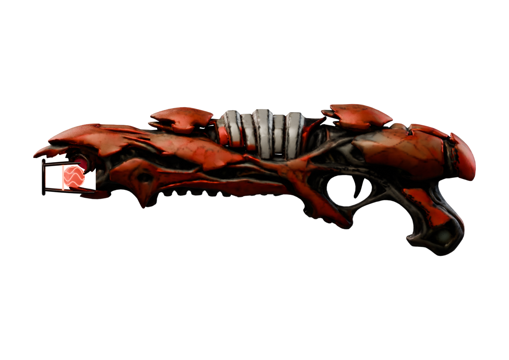
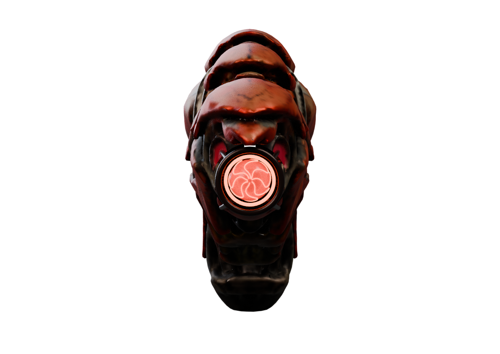

# Apoco Rifle: forward emitter and export fidelity study

**Static authoring progress only. Final art, hands, animation and native gameplay remain unaccepted.**

[Original profile and concept](https://github.com/Herbertofury/Advent-of-Ascension/wiki/Apoco-Rifle-Weapon-Profile) · [Corrected reference geometry](Apoco-Rifle-High-Resolution-Review.md) · [Evidence](apoco-forward-emitter-study.json) · [Authoring scripts](https://raw.githubusercontent.com/Herbertofury/Advent-of-Ascension/main/docs/apoco-forward-emitter-tools.zip)

## What changed

The generated reference had two side-facing red discs where the concept called for a forward emitter. This study authors an explicit forward aperture, recessed fictional energy core and open supporting cage. The energy is visible along the firing axis, and the original body remains present. A solid sleeve and generic lime dots were tried and rejected because they obscured the energy and looked pasted on.

These images are offline Blender renders of the exported/reimported asset, not generated concept art or in-game captures. The model is still visibly below the chosen concept: fine rootwork, intentional lime details, surface quality and comfortable hand/trigger construction need substantial work.

## Checks and failure lessons

- An initial exact Boolean discarded most of the shell. Clear aperture rays were meaningless in that failed result. Retained-shell geometry and visual review now precede an aperture claim.
- A self-intersection-aware Boolean retained the shell but introduced 1,284 non-manifold edges; it was rejected.
- The subsequent operation retained the shell and closed topology. Tube end caps then introduced collapsed UV triangles; explicit detail UV unwraps fixed those export issues.
- The final recorded asset has **127,510 triangles across 16 mesh objects**, no issues under the strict supported-subset preflight, and passes actual Blender import plus exact-position boundary/non-manifold checks for every object.
- This does not prove freedom from self-intersections, inter-part collisions, acceptable triangle cost, native geometry support or gameplay correctness.

## Authoring materials must survive export

A roughness-floor shader operation looked different after GLB export. The operation was baked without lighting into a standard roughness atlas, then the exported asset was reimported and rendered with matched cameras and lighting.

Foreground-masked RGB mean absolute difference was approximately **0.000102 for the side view** and **0.000458 for the emitter-axis view**, on normalized 0–1 image values. Alpha mean difference was zero in both comparisons. These are measured offline comparisons for this study, not a general material guarantee or native-engine result. The evidence retains the scope and per-view values.

## Editable reference

[Download the explicitly unaccepted forward-emitter GLB](apoco-forward-emitter-unaccepted.glb). It is an authoring reference, not an installable TaCZ pack. Check the [actual TaCZ geometry/animation contract](TaCZ-Geometry-and-Animation-Contract.md) before choosing an integration route.

## Next work

1. Rebuild deliberate organic details and material boundaries against the chosen concept; do not substitute generic glowing dots.
2. Resolve actual grip, guard, trigger and support-hand geometry with real player-arm evidence.
3. Separate intended moving parts and implement all animation states with cancellation and swept-clearance tests.
4. Verify the supported native mesh/material route, then measure gameplay, effects, frame times and startup cost.

No finished-weapon count is increased by this study.
