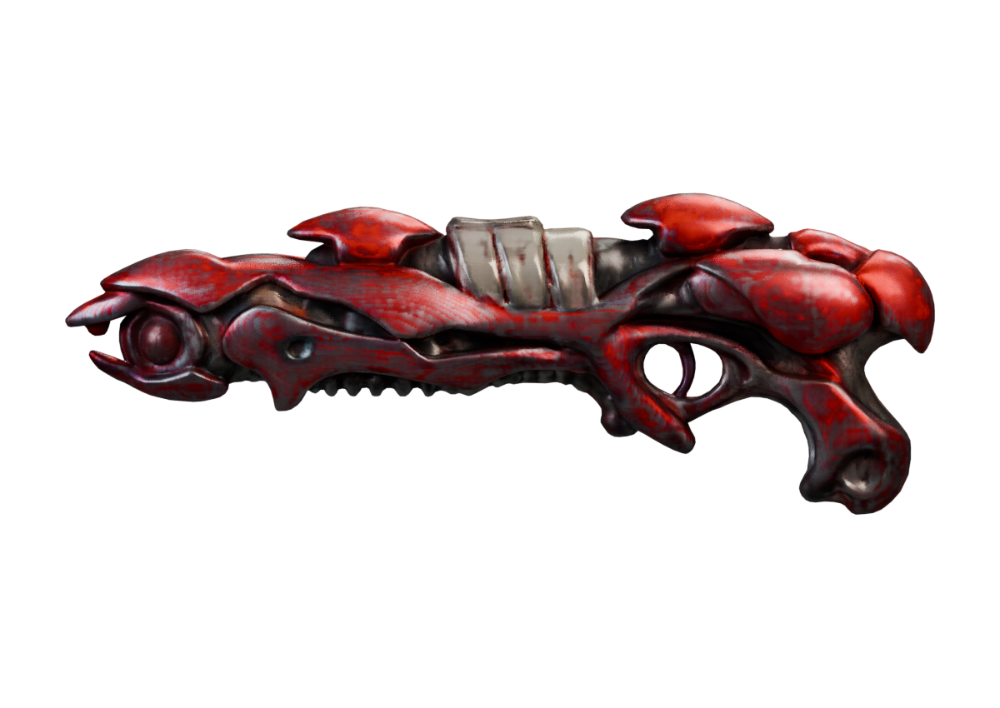
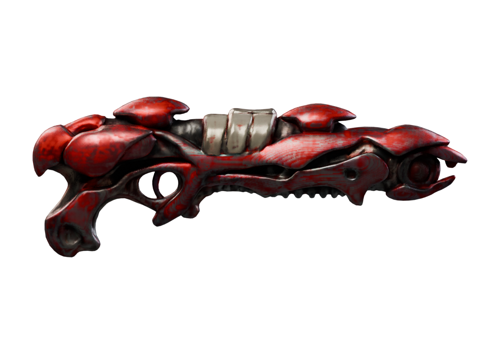
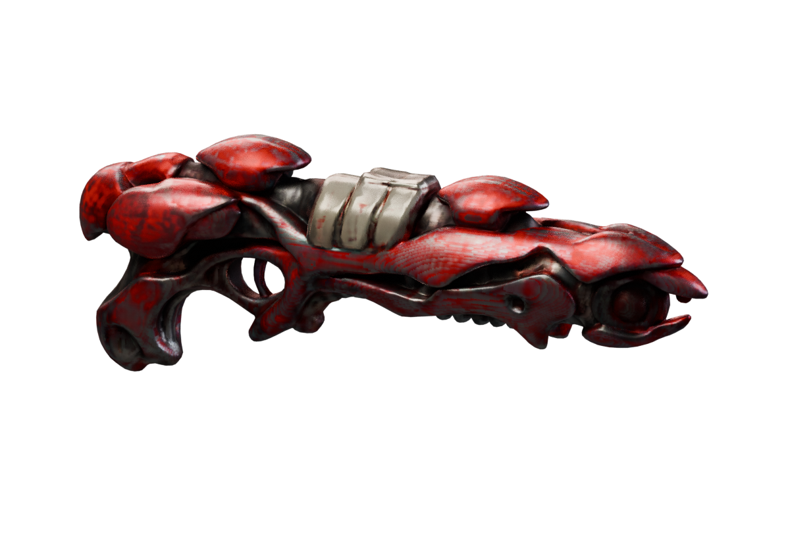
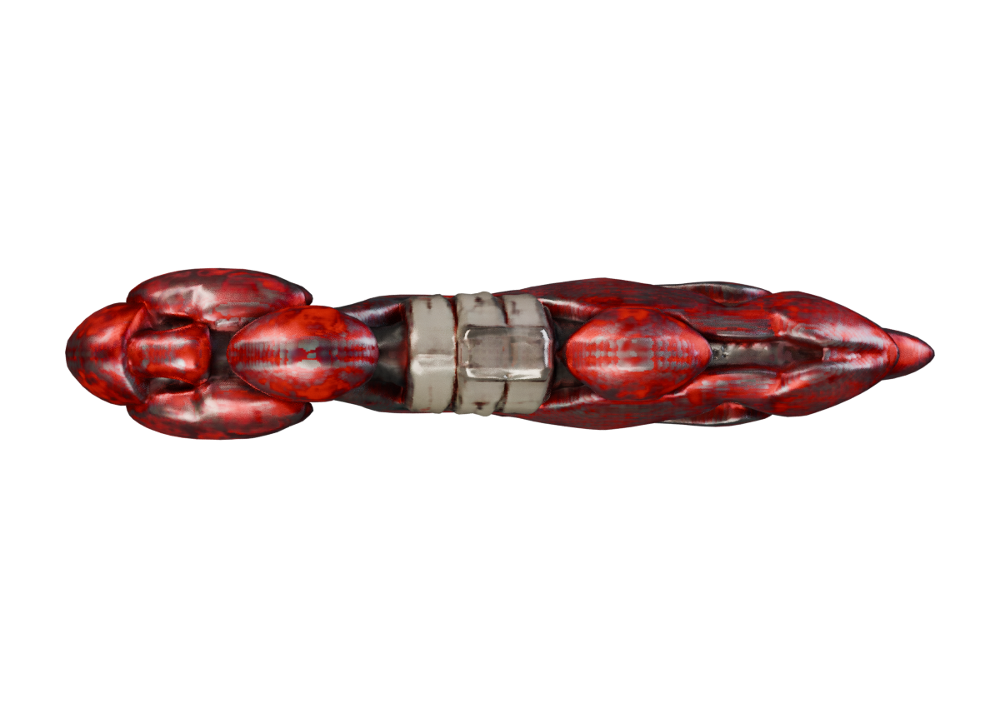
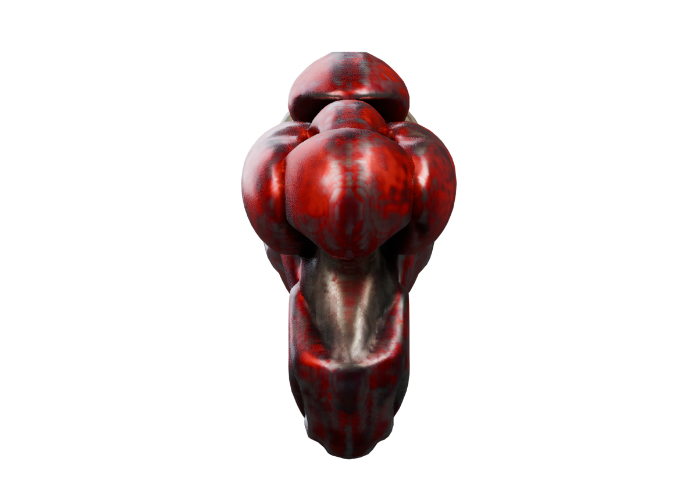
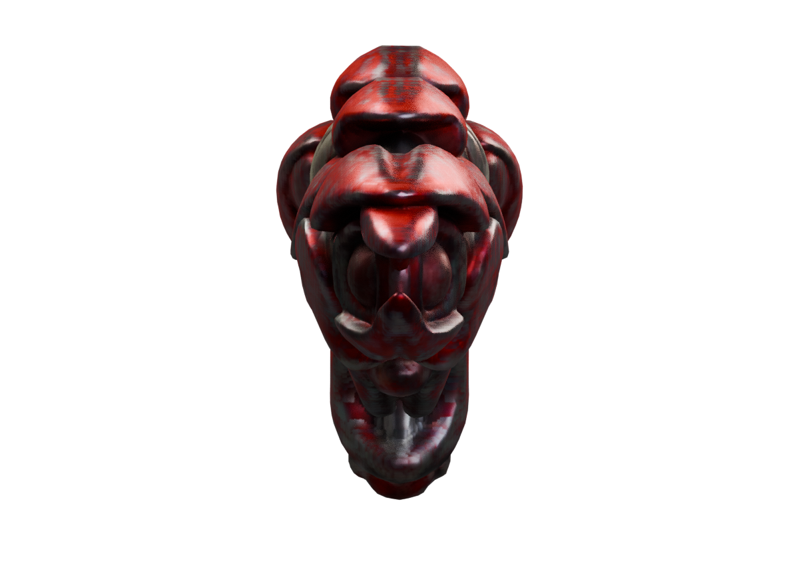

# Apoco Rifle — first complete concept-to-mesh trial

**A real generated and rendered 3D reference, not an accepted game weapon.**

The CPU-only run completed with exit code 0 after **72.5 minutes**, with observed maximum process RSS about **1.80 GiB**. The exported GLB contains **56,328 triangles**, one mesh/material primitive and two 2048×2048 embedded textures. These are offline authoring costs, not game FPS or runtime performance measurements.

## Six actual model views

These images were rendered from the exported GLB in Blender. They are neither concept art nor Minecraft screenshots. View names describe review-camera positions, not verified weapon-forward locators.

| Side | Opposite side |
|---|---|
|  |  |

| Oblique | Top |
|---|---|
|  |  |

| End A | End B |
|---|---|
|  |  |

## What improved, and what failed

The reconstruction captures the broad red-shell silhouette, pale upper bands, rear grip and trigger opening better than the rejected primitive-based blockouts. That makes it useful as a shape reference.

It still fails the intended final quality: fine rootwork and holes are softened or fused; the lime-colored details disappear from the generated texture; the emitter is a dark cap; and the surface is one fused mesh without animation-ready part ownership. The richer concept materials and detailing have not been reproduced faithfully.

A separate concept-projection experiment restored some colors but produced obvious doubled/stretched features because the reference and reconstructed geometry do not align. That experiment is rejected as final texturing. It must not be passed off as a finished high-fidelity material solution.

## Why a parser pass is not a mesh-quality pass

The bounded static GLB preflight passed and found no degenerate indexed triangles, duplicate indexed faces or collapsed UV triangles. Its 41 synthetic fixtures test the validator, not Minecraft.

The additional upstream diagnostic welded exactly coincident positions to account for UV seams. It found **50 non-manifold edges** despite zero open boundary edges. Therefore the surface has not passed topology acceptance. Index-space checks alone would have missed this issue; the UV-split mesh has 40,579 vertices, compared with 28,107 exact-position vertices.

No hand-fit, rig, reload/charge interruption, native material, multiplayer, gameplay or frame-time test has passed for this candidate.

## Next authoring work

1. Preserve the generated reference and concept, then define separate shell, frame, emitter, trigger and attachment ownership.
2. Repair topology deliberately and verify that repairs retain the silhouette and openings.
3. Author fitted UVs, material regions and actual seated emissive details. Preserve both Minecraft-fit and rich presentation options.
4. Implement animation, effects and the original authoritative Discharge Capsule behavior through the pinned native stack.
5. Run the complete weapon acceptance standard before calling it ready.

## Reproducibility and sources

- Runtime: [trellis.cpp at 8e4ce11](https://github.com/pwilkin/trellis.cpp/tree/8e4ce11a77d35c3e3a4b3f84a29d92bf5491e64e).
- Quantized model source: [pinned ilintar/trellis2-gguf revision](https://huggingface.co/ilintar/trellis2-gguf/tree/a57397bd3d351599d9729fc144b3f87c3f87d65b). The model card refers to upstream licensing; this review does not redistribute model weights or establish a blanket license for the entire toolchain.
- Trial: Q8, CPU, four threads, resolution512,12steps,60,000 face target,2048 atlas, WebP off. Files were checked against pinned size/hash before execution.
- [Structured review](apoco-rifle-trellis-review.json) and [original review tools/receipts](apoco-rifle-trellis-review-tools-v1.zip). The bundle does not contain weights, proprietary game files or a playable weapon.
- GLB SHA256: `7b61d81c576e7040f1ff53c0b69dcd1e44f2bddcb66ad753d917a48c73922180`.

[Apoco Rifle behavior and concept](https://github.com/Herbertofury/Advent-of-Ascension/wiki/Apoco-Rifle-Weapon-Profile) · [Full acceptance standard](https://github.com/Herbertofury/Advent-of-Ascension/wiki/Weapon-Completeness-Standard).
