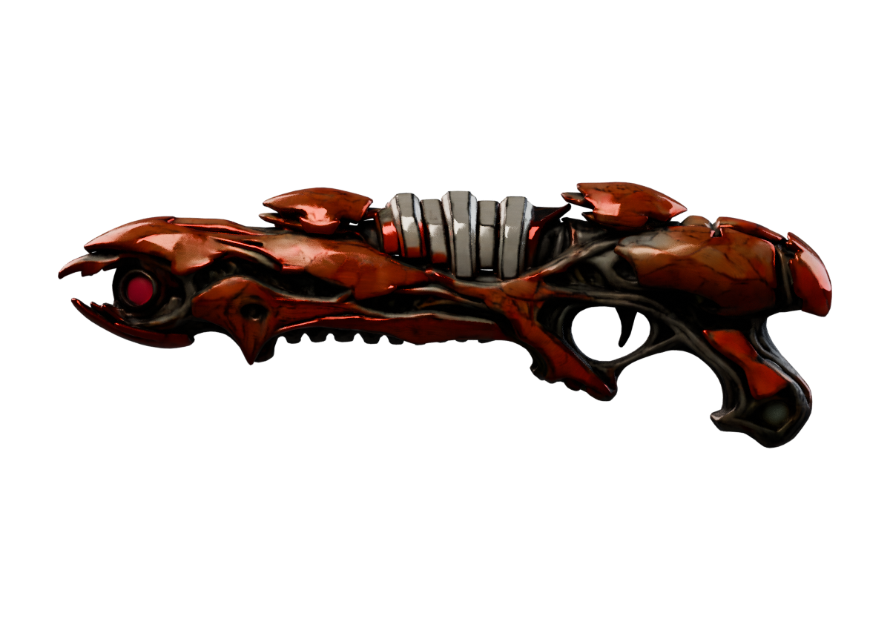
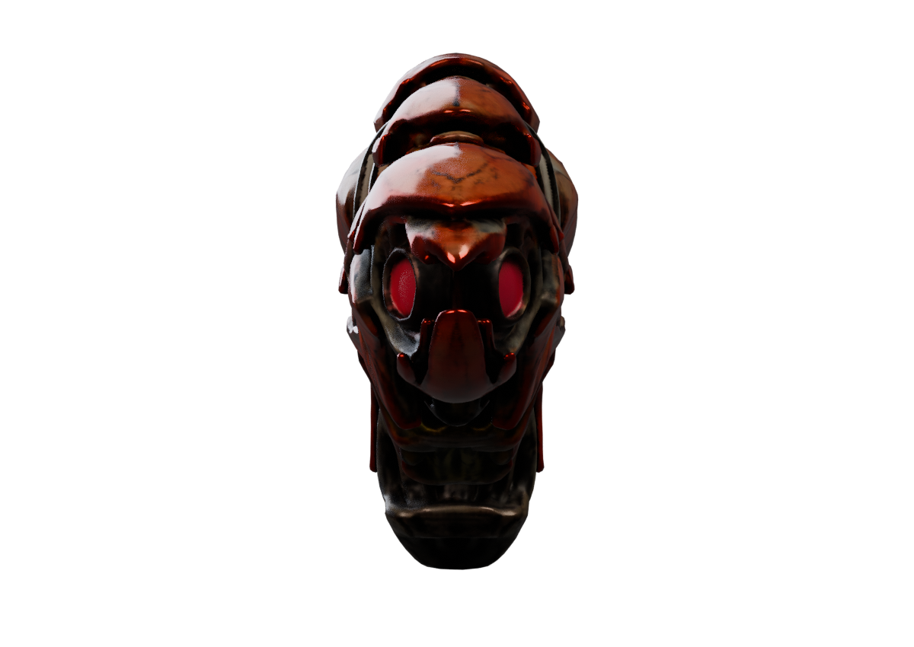
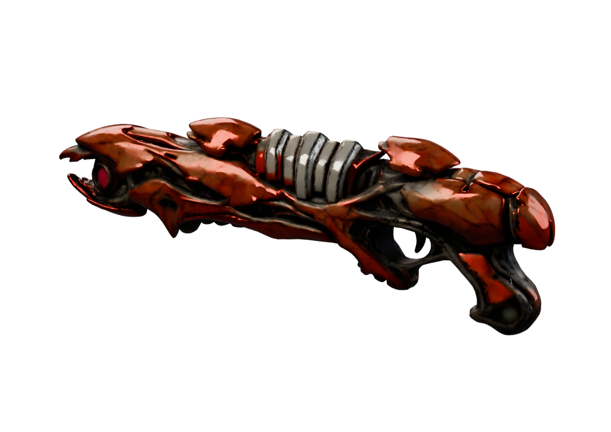

# Apoco Rifle: higher-resolution generation and repair review

[Weapon profile](https://github.com/Herbertofury/Advent-of-Ascension/wiki/Apoco-Rifle-Weapon-Profile) · [Earlier generated reference](Apoco-Rifle-Generated-Mesh-Review.md) · [Evidence](apoco-rifle-1024-review.json) · [Own review tools](apoco-rifle-1024-review-tools.zip)

## Result

**The run completed; the weapon did not pass art or native acceptance.** Increasing generation resolution retained more broad shell structure, but did not fix the important semantic mistakes: the muzzle points sideways, lime details are absent, fine rootwork is softened and the whole weapon remains fused.

These are Blender renders of exported geometry, not generated concept pictures or in-game captures.

## The decisive failed view

The side view can hide a major error. End-on inspection exposes two red side-facing discs where a coherent forward-facing emitter is needed. A successful export, attractive silhouette or higher polygon count cannot pass this defect.

## Reproducibility

Generator: [trellis.cpp](https://github.com/pwilkin/trellis.cpp), source pin `8e4ce11a77d35c3e3a4b3f84a29d92bf5491e64e`. The local run used the previously verified `ilintar/trellis2-gguf` revision `a57397bd3d351599d9729fc144b3f87c3f87d65b`. The evidence records the command, file hash and completion receipt. Original model weights and game files are not redistributed in the review-tools archive.

## Measured scope

| Check | Result |
|---|---|
| CPU generation settings | Resolution 1024, 12 steps, 8 threads, Q8 weights, 2048 atlas, 120,000 target faces |
| Process completion | Exit 0; 6,718.194 seconds, approximately 112 minutes |
| Peak child-process RSS | 4,251,232 KiB, approximately 4.05 GiB |
| Generated export | 118,026 triangles; one mesh/primitive |
| Strict supported-subset preflight | No reported structural, degenerate-triangle or collapsed-UV issues |
| Exact-position welded diagnostic | 225 non-manifold edges, zero boundary edges; not watertight |
| Static repair after re-UV and unlit PBR transfer | Initial export lost three faces, leaving nine boundary edges |
| Explicit three-hole cap repair | 120,000 triangles; zero boundary/non-manifold edges under the exact-position diagnostic |
| Native or visual acceptance | Not passed |

The final topology diagnostic does not establish self-intersection freedom, correct hand fit, moving-part clearance, animation, material fidelity or native performance. The earlier 512 run used different settings and thread count; these timings are not a controlled speed comparison.

## What the repair changes

The non-destructive repair uses a fresh mesh surface and UV atlas, then transfers base color, roughness and metallic channels without baking lighting into them. Export inspection found three tiny triangular openings that the Blender-side manifold check had missed. They were explicitly capped with winding and UV checks, and the exported file was inspected again.

This fixes a narrow geometry problem. The wrong emitter, missing lime details, fused mechanisms and local material blemishes remain. It is a better repair reference, not a completed weapon.

## Downloadable authoring reference

[Download the repaired, explicitly unaccepted GLB](apoco-rifle-1024-reference-unaccepted.glb) (approximately 9.8 MiB). It has no native animation or game integration. The muzzle orientation and visual issues described above remain. It is supplied for continued editing and reproducibility, not installation as a TaCZ gunpack.

[Read the pinned TaCZ geometry-versus-animation contract](TaCZ-Geometry-and-Animation-Contract.md) before choosing a native export backend.

## Next acceptance work

1. Rebuild the emitter with an explicit forward direction and inspect it from the firing axis.
2. Restore intentional lime details and clean material transitions against the actual concept.
3. Separate the trigger, grip-related geometry, shrouds and intended moving assemblies.
4. Fit actual native player arms and test both hand models, handedness, aim, recoil, inspect and optional reload transitions.
5. Integrate and measure the native renderer, projectiles, impacts, sound, resource accounting and multiplayer behavior.

Keep the earlier references and failed passes so a later change can be compared honestly. No native-ready badge is earned by these diagnostics alone.
