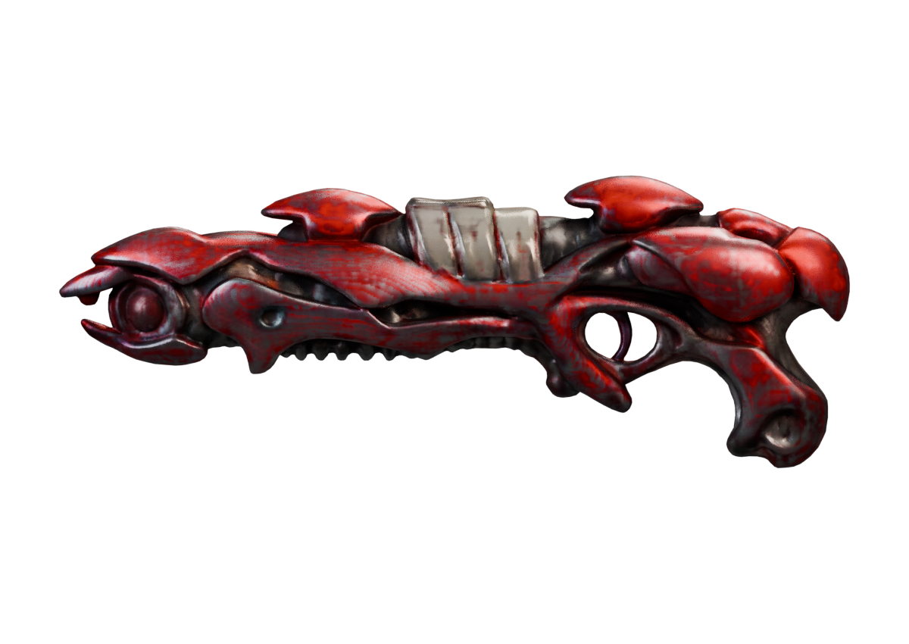
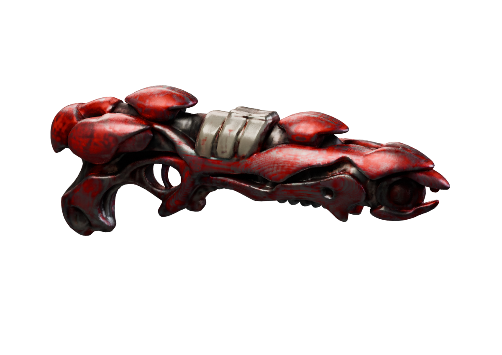

# Apoco Rifle — repairing the generated reference

**Scoped geometry/UV repair completed. The weapon still fails final art, animation and native acceptance.**

The original generated reference had 50 non-manifold edges after exact-position welding. The repaired export has **60,000 triangles, zero open boundary edges, zero non-manifold edges and zero collapsed UV triangles** under the recorded checks. This does not prove absence of self-intersections or establish a usable animated weapon.

These are actual Blender renders of the repaired GLB. They preserve the coarse generated appearance, including its remaining deficiencies; they are not Minecraft screenshots.

## Repair sequence and rejected shortcuts

1. Reconstruct the surface at authoring voxel size 0.002, retaining the original reference untouched.
2. Reduce using actual triangle count to a 60,000-triangle budget. An initial polygon-count ratio produced 120,000 triangles and was corrected.
3. Reject nearest-surface UV transfer as the final solution: it created 30 collapsed UV triangles even though geometry checks passed.
4. Unwrap the repaired surface into a fresh atlas.
5. Bake base color, roughness and metallic values through unlit emission outputs. A diffuse-color bake darkened metallic areas and was rejected.
6. Export with backface culling enabled and recheck the actual GLB, rather than accepting only the Blender scene.

The exporter warned that multiple image nodes share a packed texture. The exported texture records use the same sampler; the actual packed metallic/roughness map was checked and rendered. That warning was investigated rather than silently ignored.

## Matched visual check

Six fixed review cameras were rerendered with the same lighting, resolution and settings. Silhouette overlap with the original generated reference was approximately **99.87–99.95%**. Mean RGB differences over shared foreground were about **0.0103–0.0124** on a 0–1 scale. These measure preservation of the *generated reference*, not similarity to the concept or fidelity to original AoA artwork.

All six views were inspected. No result is promoted solely because an aggregate metric is high. The rootwork, lime accents, emitter detail, hidden-side design and part ownership still need deliberate authoring. This remains one fused mesh.

## Files and next checks

- [Exact comparison and structural receipt](apoco-rifle-repaired-comparison.json).
- [Repair source, input concept and reproduction instructions](https://raw.githubusercontent.com/Herbertofury/Advent-of-Ascension/main/docs/apoco-rifle-repair-workflow-v1.zip). No weights or proprietary game files are bundled.
- [Original generated-mesh review](Apoco-Rifle-Generated-Mesh-Review.md).

A higher-resolution reconstruction is being evaluated separately. Its result will not replace this evidence or count as a completed weapon without the same review.
