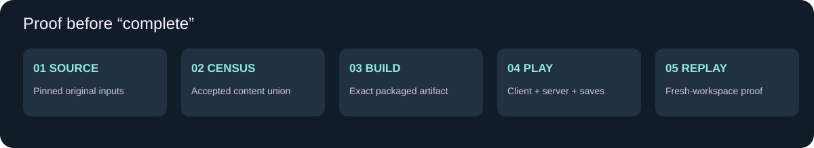

[Home](README.md) · [Versions](Version-Matrix.md) · [Worlds](Dimensions.md) · [Systems](Systems.md) · [Progress](Progress.md)

# Content completeness specification

## A record for every accepted feature

Each content record needs: stable ID, display name, category, source release/commit/hash, active/removed/unused status, historical aliases, modern counterpart, accepted behavior, target implementation location, dependencies, save schema, references/media, licensing/attribution, tests and exact result artifact.

Keep these evidence states distinct: **localization only → source declaration → implemented code/data → build packaged → runtime exercised → parity accepted**. They are not interchangeable percentages.

## Type-specific fields

| Type | Additional required details |
|---|---|
| Entity | Spawn rules, dimensions/biomes, attributes, AI, attacks, drops/trades, interaction, rendering/audio, networking and persistence |
| Boss | Summoning, arena, phases/telegraphs, reset/death, multiplayer and rewards |
| Item / weapon | Acquisition, recipe/loot, use action, costs, cooldowns, damage, durability, effects, animation, tags and integrations |
| Block / machine | States, placement/breaking, block entity, inventory/processing, redstone/automation, loot, rendering and saves |
| Dimension | Portal/key route, worldgen/biomes/structures, roster, hazards, economy/progression, return travel and migration |
| Skill | Activity eligibility, XP/formulas/caps, unlocks, UI, commands/config, sync and migration |
| Recipe / loot / trade | Inputs/conditions, outputs/probabilities, tags, modifiers, version and progression role |
| Asset | Owner/provenance, source era, intended content, animation/material metadata, runtime linkage and visual proof |

## Rules for the historical union

Preserve original identity and approved IDs; do not rename the mod to hide missing content. Do not combine incompatible releases as installed duplicates. A removed mechanic is a separate restoration decision, not automatically re-enabled because its class or texture remains. Unused/scrapped ideas must be labeled and cannot be counted as delivered content.

## Current census scope

The JSON and generated atlases cover pinned 1.16.5, 1.20 and 1.21 source signals. They do not exhaust earlier commits, all gameplay properties or the local conversion output. Earlier 1.7.10/1.12.2 branches are pinned for further archaeology. Detailed per-feature behavior receipts remain to be filled from the selected lineage and actual target testing.

---
Research snapshot: **2026-10-15**. Original documentation for the owner’s Enderloom project. Advent of Ascension is created by **Tslat** and its contributors. [Official mod/source](https://github.com/Tslat/Advent-Of-Ascension) · [Official wiki](https://adventofascension.fandom.com/wiki/Advent_of_Ascension_Wiki) · [Evidence and image credits](Sources-and-Credits.md). Source presence is not target runtime proof.
