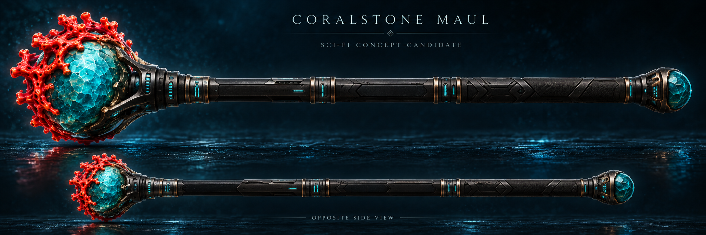

# Coralstone Maul · turquoise stone and a red coral crown

**Minecraft 1.20.1 / AoA 3.7.1 reference. Proposed premium concept, not a finished weapon model.**

## Preserve the original identity

The inspected item sprite has a rounded turquoise head, conspicuous red coral growth and a long dark banded handle. The proposed concept keeps those defining shapes rather than replacing the weapon with a generic rectangular hammer. Its extra bronze framework, sculpted coral and mineral facets are a visual design proposal, not newly implemented gameplay features.

Keep one coherent canonical construction. The larger concept-detail treatment and the simpler world-fit treatment should share its recognizable silhouette and material placement. A polished concept image is not proof that a matching model, texture atlas, hand rig or animation exists.

## Original item and native checked inputs

The registered ID is `aoa3:coralstone_maul`; its factory directly constructs `BaseMaul` rather than a special Coralstone subclass.

| Input | Inspected value | Meaning |
|---|---:|---|
| Attack damage | +26.5 | Main-hand attribute addition, not a guaranteed damage result |
| Attack speed | approximately −3.472 | THIRD modifier; approximately 0.528 attacks/second only with an otherwise unmodified base of 4 |
| Knockback | +8.5 | Base attribute addition, not a travel distance |
| Entity reach | +0.5 | Additive entity-reach modifier, not block reach |
| Durability | 1600 | Registered maximum damage value |

The complete five-maul native server fixture verified these registered inputs with AoA and TaCZ loaded together. It did not certify ordinary player-input timing, final combat damage, multiplayer or this proposed artwork.

The inherited left-click hook captures attack strength for knockback scaling; the original hurt-enemy path applies durability and restores its full base knockback modifier. Coralstone introduces no specialized effect override in the inspected factory. Do not invent coral bleeding, fire, poison, water bonuses, projectiles or resource costs because they might look thematic. The fire-coral ingredient is not evidence of a burning attack.

The inherited BLOCK use-animation enum alone does not establish an active shield-style right-click action. Preserve source combat ownership rather than converting the original item into an unrelated gun or replacing its ID.

## Exact inspected crafting recipe

The released shaped recipe produces one undamaged Coralstone Maul:

- Four `aoa3:coral_stone` ingredients.
- One `minecraft:fire_coral_block`.
- Two ingredients matching `forge:rods/metal`.

Rows, from top to bottom:

1. Coral Stone · Fire Coral Block · Coral Stone
2. Coral Stone · metal rod · Coral Stone
3. empty · metal rod · empty

AoA's own `forge:rods/metal` contribution contains `aoa3:limonite_rod`. Other loaded data packs/mods can add tag members, so do not replace the tag with a hardcoded single-item recipe. The inspected recipe is `aoa3:shaped_craft_coralstone_maul`; its result count is 1 and result Damage is 0. The recipe/loot-JSON scan found this recipe but no loot-table JSON reference to the maul; that does not exclude code-side or other acquisition routes.

## Modeling and presentation target

- Sculpt the stone as a weighty compact mineral head with deliberate planes, not an oversized sphere pasted onto a plain stick.
- Build coral as anchored, tapered branching forms with readable negative spaces. Keep attachment points coherent across opposite views.
- Preserve the red/turquoise hierarchy at ordinary gameplay distance. Microdetail must not be required to recognize the item.
- Make bronze sockets, pale bands and grip wraps real, consistent model/material features rather than baking a beauty render across mismatched geometry.
- Author both-hand handling, wind-up, contact and recovery around the original melee input. Decorative motion must not create duplicate hits or change the reach/knockback contract.
- Keep the world-fit and concept-detail treatments selectable without changing gameplay, saves or the original item identity.

## Remaining gates

- [ ] Build the editable original model and UV/material layout against this concept, including opposite and rear views.
- [ ] Produce both visual treatments and compare them in ordinary AoA + TaCZ gameplay.
- [ ] Bind hands and melee animation to the actual original input/events; preserve misses, interruption, charge and recovery.
- [ ] Verify contact, camera clearance, both hands, other held items, resource reload and fallback rendering.
- [ ] Test recipe/tag resolution, normal combat, shield interactions, durability, server authority and multiplayer.
- [ ] Measure frame time, memory, LOD behavior and dense-scene cost before calling the asset optimized.
- [ ] Obtain visual acceptance separately from source/build/native fixture results.

## Evidence and credits

- AoA by Tslat and contributors. Original item/recipe references were inspected privately from the exact AoA 3.7.1 release; this new concept is not an official AoA asset.
- [Shared first-target maul behavior and retained Electron correction](https://github.com/Herbertofury/Advent-of-Ascension/wiki/Maul%E2%80%90Inputs%E2%80%90and%E2%80%90Effects%E2%80%901.20.1).
- [Pinned shared BaseMaul source](https://raw.githubusercontent.com/Tslat/Advent-Of-Ascension/0be2106bebb3851c5ba2cc9974e57936a867244d/source/content/item/weapon/maul/BaseMaul.java).
- [Original native server fixture source and reproduction instructions](https://github.com/Herbertofury/Advent-of-Ascension/blob/main/docs/Maul-Native-Fixtures-v1.zip).

## 2026-10-29 science-fiction concept candidate

The new candidate retains the turquoise head, red coral crown and dark shaft while replacing much of the medieval ornament with graphite/titanium detailing. The full side silhouette uses a wide canvas rather than bending the shaft. The earlier canonical study above remains preserved. This is not an accepted model, native effect or animation. [Five-maul review and remaining scope](Maul-Concept-Revision-2026-10-29.md).
