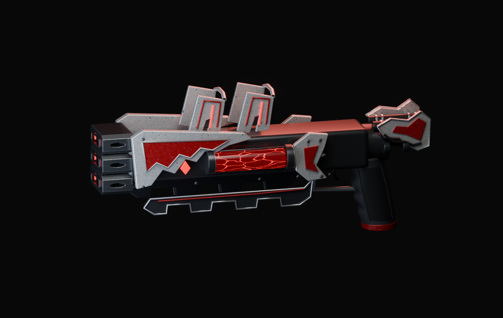

# Discharge: muzzle, enamel and chamber refinement

# Discharge authoring refinement v15

**Unaccepted work in progress. This is not a playable TaCZ gunpack.**

Open `discharge-finish-study.blend` in Blender 4.3.2. It contains owned editable parts and procedural materials, including authoring-only chamber shader keyframes. No original weapon resource, projectile count or damage behavior is changed.

## Changes and checks

- Three discrete dark muzzle housings with narrow metallic edges, open front regions and six actual side vents.
- Redundant legacy side walls were removed after visual inspection caught the new cuts being covered from behind.
- White/red enamel has sparse chips, varied roughness and subtle microtexture in shared root coordinates.
- Distracting bright metallic chamber helices were replaced by dark longitudinal supports; the energy pattern is sparse, warped and red. Its shader-time keys are not native game animation.
- 57,608 evaluated triangles; no reported nonfinite vertices, area<=1e-12 triangles or negative-volume closed objects in the neutral-pose checker.
- 297 frontal interior samples and 54 side-vent samples show no obstruction in their defined opening regions. These sparse rays do not prove full continuous, oblique or animated clearance.

## Rebuild

From the bundle root, run each `build.py` in this order with Blender 4.3.2:

1. discharge-sculpt-v7
2. discharge-authored-muzzles-v9
3. discharge-authored-muzzles-v12
4. discharge-material-study-v13
5. discharge-energy-study-v14
6. discharge-finish-study-v15

Command form: `blender -b -t 4 --python-exit-code 1 --python DIRECTORY/build.py`.

Older generator outputs are preserved locally. This bundle includes the rebuild chain and final source rather than every redundant intermediate .blend file. The selected concept is linked in the public weapon profile; it is not replaced by this source.

## Still fails acceptance

The receiver's top/underside and rear assembly remain too plain relative to the selected concept. Grip detail, sculpted craftsmanship, texture art and complete effects require more work. Native hands, reload/interruptions, emitter bindings, material export, projectile/impact fidelity, crafting, attachments, multiplayer and measured performance are untested. New geometry/materials invalidate old texture bakes until regenerated and checked.

The original Discharge baseline is four projectiles per burst using Discharge Capsules. Three visible channels are a visual design, not permission to change that behavior. Cosmetic chamber energy is not a new mana requirement.

[Editable source and scoped checks](discharge-authoring-refinement-v15.zip) · [Owner target and original behavior](https://github.com/Herbertofury/Advent-of-Ascension/wiki/Discharge-Shotgun-Weapon-Profile)
