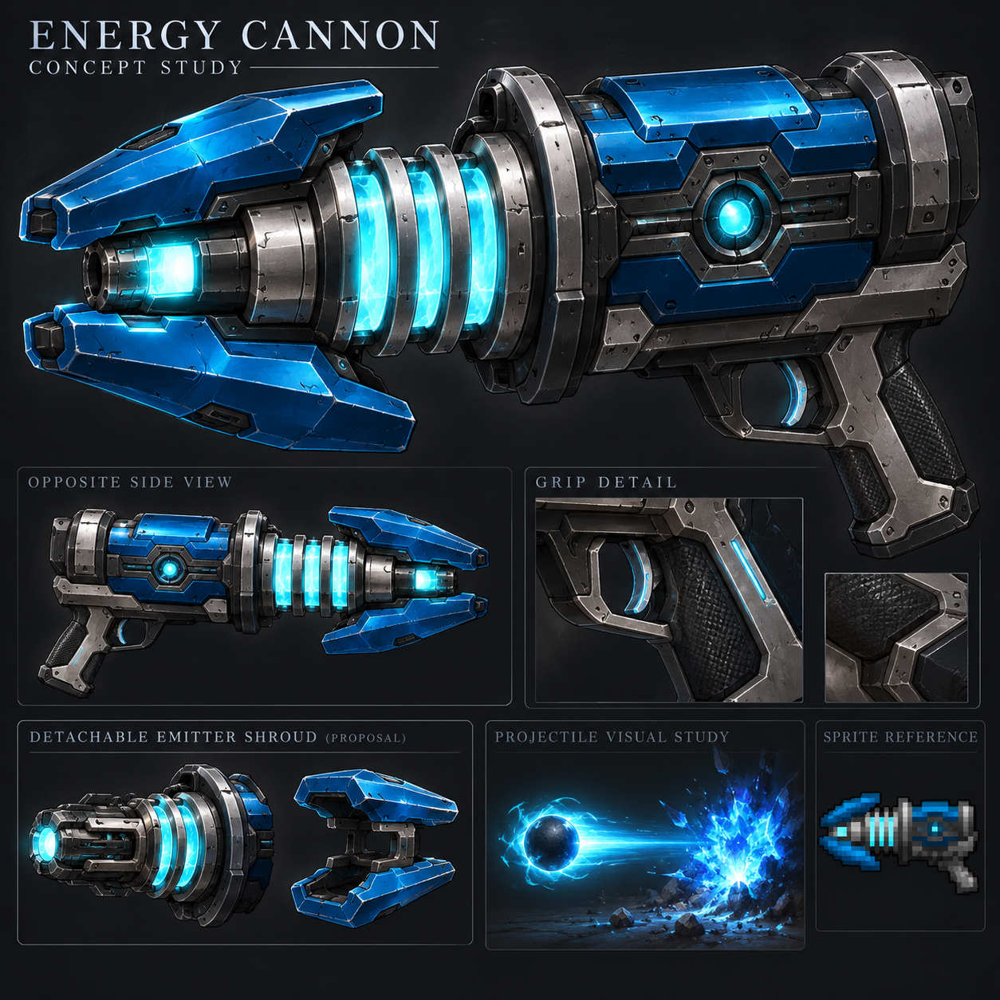

# Energy Cannon

[Armory](https://github.com/Herbertofury/Advent-of-Ascension/wiki/Weapon-Overhaul) · [Moon Cannon upgrade](https://github.com/Herbertofury/Advent-of-Ascension/wiki/Moon-Cannon-Weapon-Profile)

## The recognizable original

A compact blue split-jaw cannon with three cyan neck bands, a dark rounded rear chamber and a small cyan center detail. Preserve the smooth upper chamber: the raised magenta dorsal details distinguish its Moon Cannon upgrade.

Despite the name, the pinned release inherits **Cannonball ammunition**. It is not a free-firing mana weapon. Its special identity is its split heavy/energy damage routing.

## Premium redesign concept

**Design study, not an accepted playable asset.** The detachable shroud and cyan projectile/impact are proposed visual work. They do not demonstrate original flight, terrain destruction, area damage, correct hand fit or actual native animation. The opposite-side view and grip detail must be reconciled into one coherent model.

## Released behavior: 1.20.1 / AoA 3.7.1

[Version-pinned source record](energy-cannon-source-evidence.json)

| Property | Source input / behavior |
|---|---|
| Registered damage | 18.5 |
| Durability | 610 |
| Delay | 25 ticks |
| Recoil constructor input | 0.21; not a measured camera motion |
| Base ammo | Cannonball |
| Full automatic | No |
| Projectile | EnergyShotEntity, age parameter 120, piercing parameter 0 |
| Impact routing | 75% heavy-gun helper, then 25% energy helper |
| Sound | ITEM_ENERGY_CANNON_FIRE |

Final damage depends on the living-target attribute adjustment and the damage helpers. The energy branch is still attempted if the heavy branch rejects its attack; do not silently replace the two paths with one combined hit. Conditional knockback and interruption behavior need native tests.

## Illustrated crafting and upgrade path

The released recipe is **infusion**, not a shaped crafting-grid recipe. Treat the duplicated ingredient entries as two required ingredient entries; do not merge them into a single free ingredient.

| Ingredient | Listed entries |
|---|---:|
|  Cannon Frame | Input item |
|  Runic Energy | 2 |
|  Power Core | 1 |
|  Elecanium ingot tag | 2 |
|  Energy Cannon | Result |

1. Obtain the Cannon Frame and the listed infusion ingredients in the selected release.
2. Use the release's infusion system; this is not a vanilla crafting-table layout.
3. Verify the resulting Energy Cannon and its ammunition before optional visual conversion.
4. Later, the packaged upgrade-kit recipe combines it with  **Lunar Upgrade Kit** to produce the Moon Cannon.

That upgrade changes registered damage to 21 and durability to 855 while retaining the inspected 25-tick delay and split heavy/energy routing. It is a verified recipe relationship, not a claim that the two weapons share identical projectile rendering or every inherited behavior.

## Proposed movement, effects and customization

- Pulse cyan bands toward the muzzle during the shot, with a brief readable core flash and a weighty recoil recovery.
- Keep the blue jaws as structural shrouds; a precision shroud variant should visibly differ and declare its gameplay tradeoff.
- Add a stabilizing brace, optional lens sight, earned charm mount and removable decorative panels with real clearance tests.
- World-fitting textures and a premium material mode share the same recognizable silhouette and attachment ownership.
- Optional reload presentation preserves cannonball accounting. Disabling reloads must retain native cadence and valid resource state.
- Optional tracers, impacts, decals, finishers, skins, emblems and static/animated/glowing stickers stay explicitly configurable, bounded and server-safe.

## Acceptance still required

Original flight/impact game captures; source-faithful model; consistent views; topology/UV/material review; native wide/slim arms and both handedness settings; equip/idle/aim/fire/inspect/optional reload transitions; sound and VFX timing; attachment/crafting/salvage persistence; multiplayer authority; measured startup and frame-time costs. No native acceptance is claimed by this concept or source inspection.
