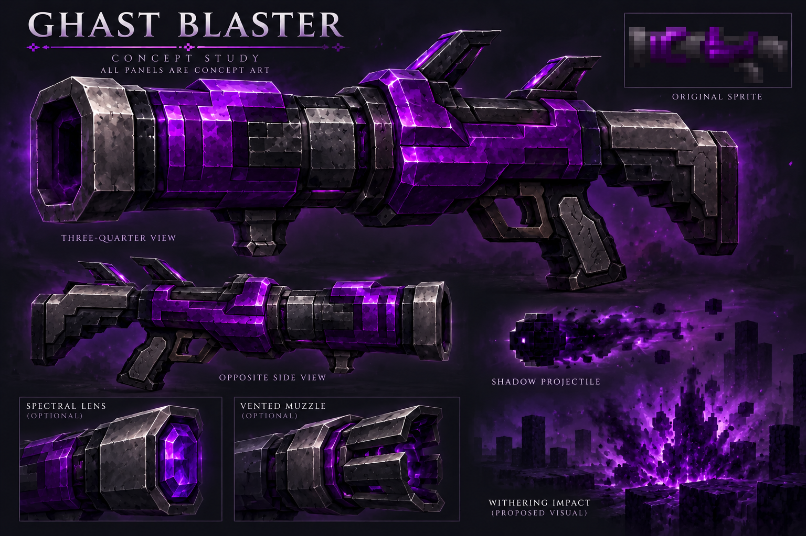

# Ghast Blaster

[Armory](https://github.com/Herbertofury/Advent-of-Ascension/wiki/Weapon-Overhaul)

## Preserve its original identity

The original is a dark purple cannon with gray muzzle bands and swept black upper fins. The premium direction keeps this silhouette and palette. Its name alone is not a reason to replace it with a white Ghast-head novelty gun.

## Premium concept

**All panels are concept art.** The projectile, impact, spectral lens and vented muzzle are proposed presentation studies, not game captures or implemented features. Opposite-side construction, support grip, trigger clearance and the two dorsal fins must resolve consistently in the actual model.

## Released behavior

Pinned **AoA 3.7.1 / Minecraft 1.20.1**. [Evidence](ghast-blaster-source-evidence.json).

| Property | Source observation |
|---|---|
| Registered damage | 20 |
| Durability | 600 |
| Firing delay | 28 ticks |
| Constructor recoil input | 0.2 |
| Base ammo | Cannonball, inherited BaseCannon |
| Projectile | HeavyShadowballEntity |
| Age / piercing input | 120 / 0 |
| Gravity return | 0.1 |
| Special effect | Withering-target tooltip; effect builder receives duration 100 and level argument 2 |
| Firing sound reference | ITEM_LIGHT_CANNON_FIRE |

The raw builder level argument is recorded without guessing its amplifier semantics. The effect is restricted to living targets, and the inherited BaseCannon path calls the impact effect after its heavy attack is accepted. A miss, rejected hit or ineligible entity must not receive the effect simply because a cosmetic impact played. Final damage and status timing require native verification.

## Crafting and upgrade lineage

The packaged infusion recipe uses a **Cannon Frame** as input, plus:

- Ghoulasm
- Wither Rune
- Unstable Gunpowder
- Two Ghastly ingot-tag entries
- One Iron ingot-tag entry

Its output is Ghast Blaster. This is an infusion recipe, not an invented shaped crafting grid. A separate packaged upgrade recipe combines **Ghast Blaster + Predator Upgrade Kit → Predatorian Blaster**. Preserve that item's separate identity and audit its own behavior before redesigning it.

These ingredients support the design's ghostly/withering interpretation, but do not establish an invented maker, civilization or exact source biome.

## Proposed feature set

- Weighty cannon recoil with a restrained violet discharge pulse; keep target visibility clear.
- A dense shadow projectile visual and brief withering impact accent, with scalable particle budgets.
- Inspection that reveals a spectral core behind a controlled shutter, returning completely before fire resumes.
- Optional spectral-lens, vented-muzzle, stability and sight assemblies with visible, declared effects.
- Earned charm mounts, skins, stickers, animated/glowing emblems and configurable tracer/impact/defeat effects.
- Both world-fitting and premium appearance modes; original-mode fallback remains usable.
- Optional reload presentation must conserve native Cannonball cost and work correctly when disabled.

## Quality gates

Verify the original projectile in flight and on impact; compare the released sprite and concept; check all-angle proportions; keep moving assemblies distinct; test native wide/slim arms, both handedness settings and attachment sweeps; verify interruption blends, audio/VFX synchronization, crafting/salvage persistence, multiplayer authority and measured performance. None of these gates is passed by this sheet alone.
