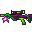
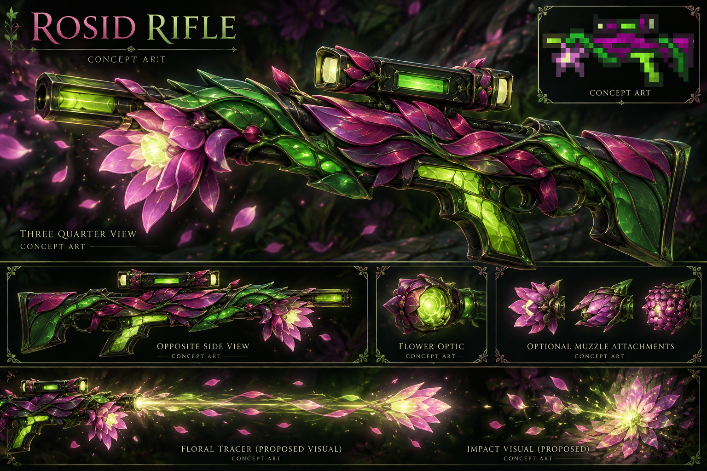

# Rosid Rifle

[Armory](https://github.com/Herbertofury/Advent-of-Ascension/wiki/Weapon-Overhaul) · [Pinned source evidence](rosid-rifle-source-evidence.json)

**Concept art, not an implemented or accepted native weapon.** The separately displayed original PNG is extracted from the pinned release; the small inset inside generated art is illustrative. The flower, optic, attachments and tracer are proposals. Real hand space, moving-part ownership and matching opposite-side construction remain to be resolved.

## Identity and concept

The released sprite has a plum/magenta body, deep green frame, bright lime details, a rectangular dark scope with pale lenses and a distinctive flower-like muzzle cluster. Preserve that botanical identity in both world-fitting and premium visual modes.

## A source discrepancy worth fixing

The AoA 3.7.1 English tooltip says **“Spawns a friendly Rosid on successful hit.”** However, the inspected RosidRifle `doImpactEffect` method contains only a return. The tooltip is therefore not proof that this feature works in this release. This inspection does not establish whether an unrelated global handler could add behavior; native reproduction and wider source tracing remain necessary.

The restoration backlog should establish the intended friendly creature, ownership, lifetime, damage attribution, spawn limits, removal, save/reload and multiplayer behavior before adding that feature. A cosmetic muzzle flower cannot substitute for a working companion mechanic, and a presentation-only conversion must not silently add server gameplay.

## Version-specific baseline

| Property | AoA 3.7.1 / Minecraft 1.20.1 |
|---|---|
| Registered damage | 45.5 |
| Durability | 405 |
| Delay | 102 ticks |
| Constructor recoil input | 0.035 |
| Base ammunition | Metal Slug, inherited BaseSniper |
| Automatic | No |
| Scope selection | SCOPE_2 override |
| Projectile | Inherited SniperSlugEntity |
| Impact effect hook | Empty in this inspected release |

These are source values, not guaranteed final damage or measured recoil. Inherited sniper rules, target handling and resource consumption remain relevant. No recipe or loot-table reference was found by scanning packaged JSON recipe/loot entries for this exact item ID; that does not prove all acquisition routes are absent.

## Proposed design work

A restrained petal pulse accompanies the shot; a lime focus point remains readable without overwhelming bloom. A floral lens sight, alternate petal shroud, leaf-like stability frame and earned botanical charm provide distinctive modular options. Keep inspect motion, optional reloads, charms, skins, stickers, tracer/impact/defeat effects and performance budgets explicit. Original projectile captures, real native hands and all gameplay/animation gates remain open.
