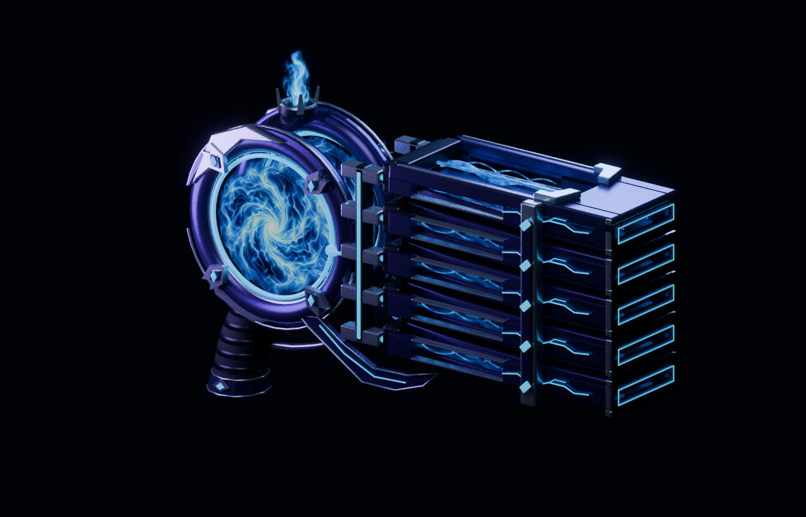
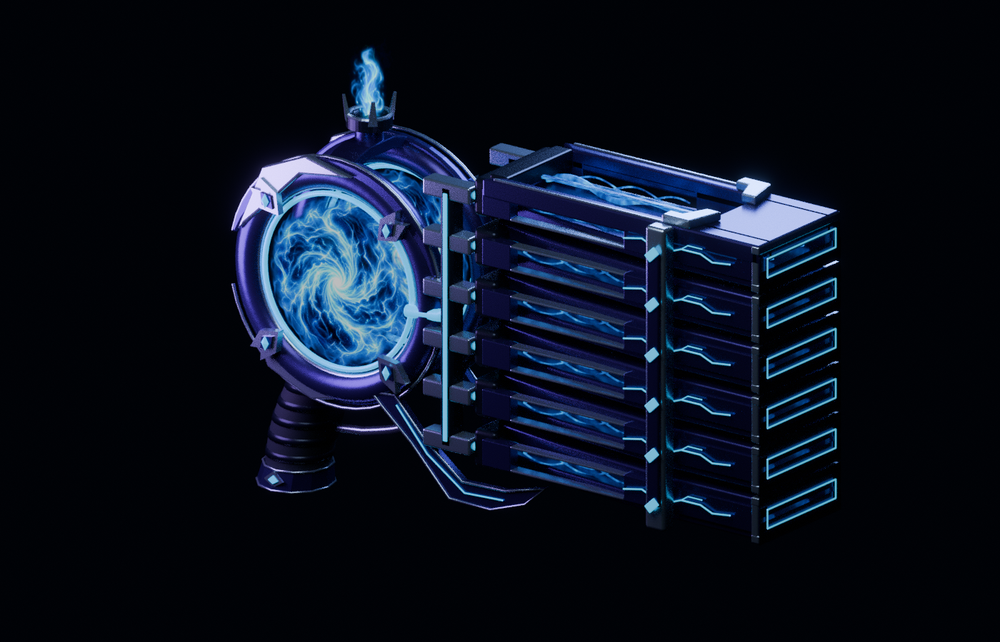

# Soul Storm: five- and six-emitter authoring studies

# Soul Storm five- and six-emitter studies

**Unaccepted authoring and transport assets. Not a functional gunpack or finished upgrade.** The four-emitter base remains separate and unchanged.

## Actual modeled changes

Both variants preserve the original emitter pitch and independently owned parts. The front supports, rear distribution manifold and fixed sleeve positions now match the selected count. The lower wing and its borders share a deformation so the taller stack has room below it.

The first static variant failed review because its rear manifold still had four-emitter height. The corrected version extends the manifold and its energy seams. The six-emitter focused reticle initially cleared the forward hardware's vertical bound by only 0.005 authoring units. A physical 0.22-unit riser raises the entire brazier, rooted fire, reticle and anchor together; the original saddle stays attached to the core. The resulting bound clearance is 0.225. This is a provisional authoring margin, not universal native ADS/FOV acceptance.

## Scoped checks

- Five-emitter scene: 57,424 evaluated triangles. Six-emitter scene with riser: 65,100. Neutral geometry checks report no nonfinite vertices, near-zero-area triangles or negative-volume closed objects.
- All 10/12 fixed sleeves overlap their matching rear manifold's AABB. AABB overlap is not proof of exact solid contact.
- Focused reticle lower-bound clearance: 0.365 / 0.225 authoring units for five/six emitters.
- Recoil keys animate X only. The variant Z offsets remain unchanged across the sampling test, preventing the larger stack from snapping back into its original four-slot layout.
- 105 / 126 sampled active-clip poses show no triangle-surface intersection between the lower wing/borders and moving emitter parts. Other pairs, containment, unsampled continuous motion, hands and native collision remain open.
- Eleven position clips contain 462 keys across body/illuminated bone pairs. Actual released TaCZ 1.1.8-hotfix2 parser bytecode accepts them on Java 17 and 21 with documented narrow helper stand-ins. The maximum sampled linear approximation error is below 0.011485 model units.

The six-frame event spacing is an authoring fixture, not a validated production firing rate. Actual AoA resource, charge, delay and projectile behavior must remain server-controlled. More barrels may become functional upgrades under the agreed design, but these files do not yet implement increased damage, projectile count or resource costs.

## Geometry transport boundary

The accompanying TML files contain opaque hardware only, using constant-color swatches. They intentionally omit the vortex, procedural plasma channels, living fire and reticle surfaces. The authoring renders therefore show effects absent from this transport fixture.

| Variant | Hardware mesh bones | Hardware triangles | Released-baker vertices |
|---|---:|---:|---:|
| Five | 12 | 36,256 | 145,024 |
| Six | 14 | 40,316 | 161,264 |

Original and compact geometry produce exactly identical released-baker float arrays on Java 17 and 21: 1,160,192 values for five emitters and 1,290,112 for six. Compact files are approximately 22.9% / 23.2% smaller. This is byte/storage evidence, not an FPS or loading-time benchmark. The previously identified fallback normal-sign question still requires real rendering tests.

The asset contract verifies that every sampled clip addresses its matching body/illuminated geometry bones, and rejects a missing last emitter. Matching names alone do not establish native animation playback.

## Reproduction and remaining work

Final editable scenes are under soul-storm-stack-recoil-v1/5 and /6. Open them in Blender 4.3.2. The build chain is:

1. Obtain the earlier published v22 authoring source in sibling soul-storm-sculpt-v22.
2. Run soul-storm-stack-variants-v2/build.py.
3. Run soul-storm-stack-variants-v3/raise_sight.py.
4. Run soul-storm-stack-recoil-v1/build.py and its layout/motion checks.
5. Export each final scene with the matching soul-stack-transport-v1/5 or /6/export_geometry.py.
6. Run the separately documented pinned parser, TML baker and float32-compactor tools; local dependencies are not redistributed.

Still required: better concept-faithful sculpting and texture work; full effect/material export; hand and first-person aim poses; interruption-safe native animation; five/six-emitter damage/resource policies; crafting and progression; original projectile/impact captures; multiplayer and compatibility tests; measured native frame/tick/memory costs. Neither variant passes final visual or native acceptance.

[Editable scenes, generators, clips, transport files and checks](soul-storm-stack-studies-v1.zip) · [Earlier v22 source](soul-storm-v22-authoring-study.zip) · [Released parser harness](tacz-released-parser-check-tool-v2.zip) · [Released TML baker harness](tml-released-baker-v3.zip) · [Float32 compactor](tml-float32-export-v1.zip)
