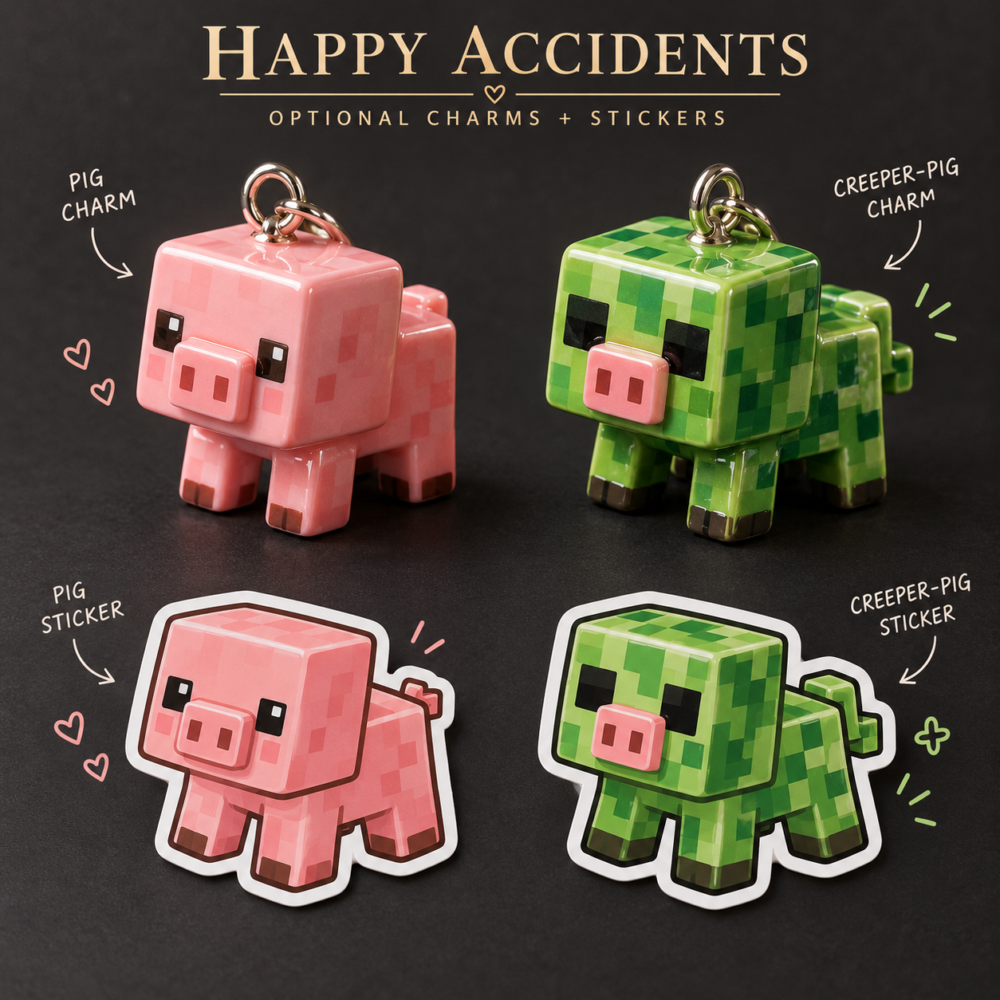

# Boom Boom · Happy Accidents cosmetics

Concept study, 2026-10-27. Original AoA identity: Tslat and contributors. These optional accessories do not replace Boom Boom's green Creeper-themed body or its gameplay.

## Four independently selectable cosmetics

- Pink pig charm: blocky pink pig with a visible attachment loop.
- Creeper-pig charm: an original green hybrid gag with a pig snout and Creeper-inspired pattern, not a claim that this hybrid is a canonical mob.
- Matching pink pig sticker.
- Matching Creeper-pig sticker.

All four must be optional and removable. Neither creature should become the main receiver, muzzle or weapon body. The sheet is a concept proposal, not user-approved final art or a game-ready mesh/texture.

## Implementation acceptance still required

Keep charm anchors outside hand, trigger, reload/service and sight paths. Test sway at idle, movement, aiming and inspecting; prevent clipping and distracting screen coverage. Provide a reduced-motion option. Stickers should preserve the underlying material and remain legible at the game's actual texture resolution. Test UV seams and configurable sticker placement. Do not infer dimensions, collision behavior or implemented physics from the illustration.

Charms and stickers must not alter damage, resource consumption, spread, projectile rules or progression. No cosmetic option is mandatory for the base weapon. Inspect animation, in-world material fidelity and native client/server tests remain open.

## Researched references for the separate main-art brief

[Mojang's Creeper history](https://www.minecraft.net/en-us/article/meet-creeper) describes its accidental origin while making a pig. It leaves flesh/leaves/fur interpretation unresolved, so vegetation anatomy is not asserted as canon.

[Mojang's music-disc article](https://www.minecraft.net/en-us/article/taking-inventory--music-disc) supplies the skeleton-arrow/disc connection. A tiny arrow-and-disc service emblem is a proposed visual nod; the article's historical disc total is not treated as current.

The [official Minecraft D&D compendium](https://www.minecraft.net/content/dam/minecraftnet/games/minecraft/software/Minecraft-Monstrous-Compendium-revised.pdf) also describes feline fear and a charged blue aura. Those support small visual references only, not importing its D&D damage, duration or immunity into AoA.

The requested new Boom Boom main artwork remains unfinished after an image-service block. The existing main concept remains available. This separate cosmetic sheet does not complete that request.
